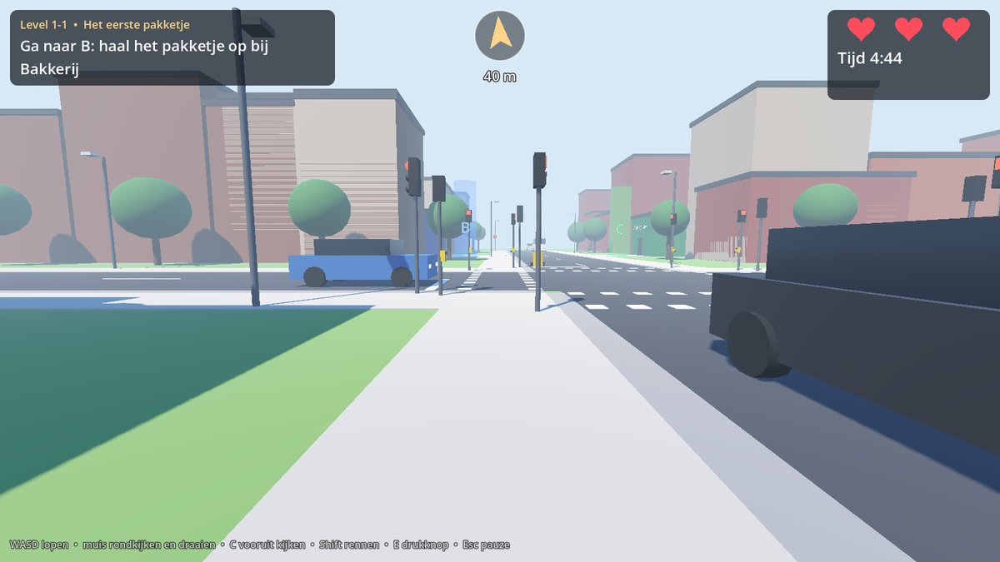
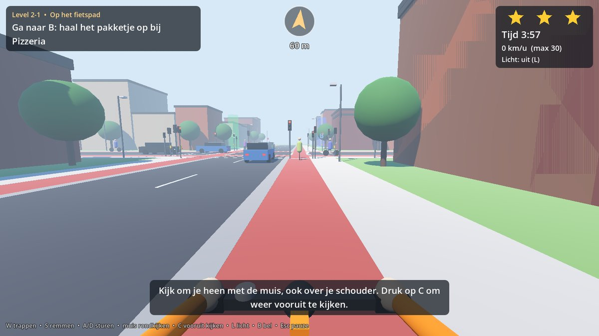
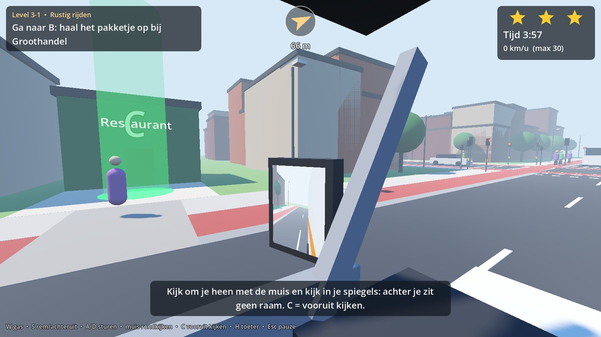
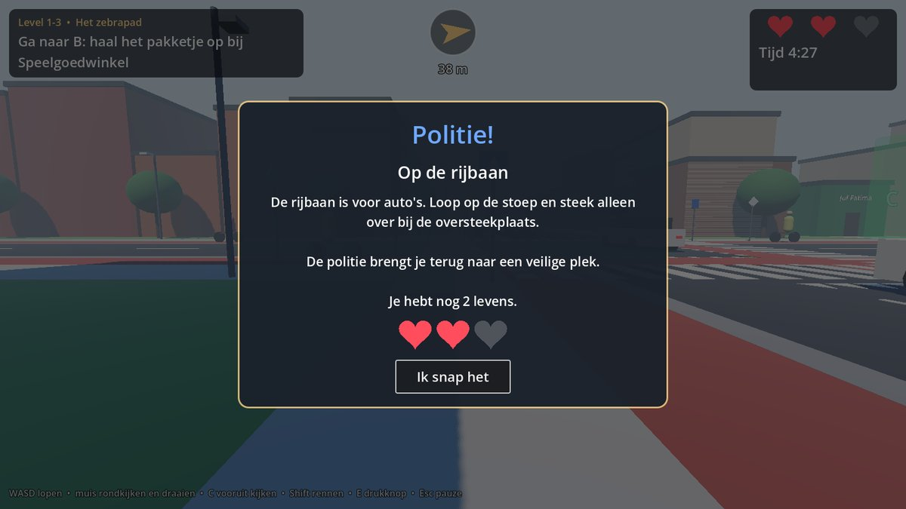
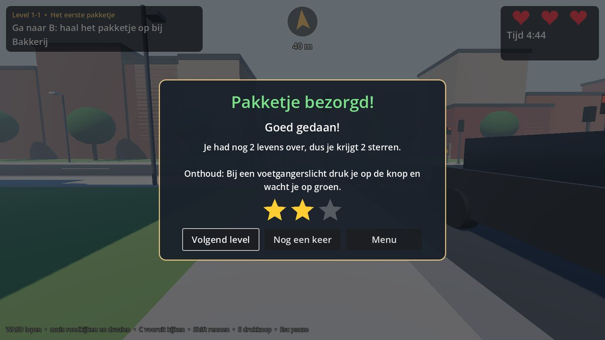

# Escape the Streets

A road-safety game for children aged 6–12, built in **Godot 4.7.2** for PC, with Dutch traffic rules and Dutch in-game text.
You are a delivery courier: pick up a package at **B** and deliver it at **C**, without causing or having an accident.
Stage 1 is on foot, stage 2 on a bike, stage 3 in a delivery van. Each stage has 10 levels.

This is a **playable greybox prototype**: all gameplay systems work, but everything is drawn with boxes, spheres and cylinders, and the sounds are generated in code. The art and audio pass comes next.



## Quick start

1. Install **Godot 4.7.2** (the standard version, not .NET).
2. Start Godot, choose **Import**, select `project.godot` and click **Import & Edit**. The first import takes a minute.
3. Press **F5** to start at the main menu. When you run from the editor, all levels are unlocked ("testmodus").
4. To jump straight into a level, open `scenes/level.tscn` and press **F6**. That plays level 1-1.

## Controls and views

| | On foot | Bike | Van |
|---|---|---|---|
| View | **First person** at a child's eye height (1.35 m) | **First person** (rider's eyes) | **First person** (driver's seat, left) |
| Move | WASD | W pedal, S brake | W accelerate, S brake/reverse |
| Steer / turn | Mouse turns you | A/D | A/D |
| Mouse | Look around: you turn your whole body, and look up and down | **Free look**: turn your head up to 150° (look over your shoulder) | **Free look** up to 140°; the van has no rear window, so use the **side mirrors** |
| Look ahead again | C or middle mouse button | C or middle mouse button | C or middle mouse button |
| Extra | Shift run, E push button | L bike light, B bell | H horn |
| Pause | Esc | Esc | Esc |

Looking around is part of the lesson. On foot you see the street from a child's height, so parked cars and corners hide more. On the bike you check over your shoulder before you cross or turn, and in the van the pillars by the windscreen and the closed load area create real blind spots (dode hoek), so you have to move your head and check the mirrors.
Set `auto_recenter` on the Courier node if you want the view to turn slowly back to the front while riding.

The keys are physical keys, so WASD sits in the same place on AZERTY keyboards (Belgium). Edit them in *Project → Project Settings → Input Map*.

| Bike (first person) | Van: looking left at the mirror |
|---|---|
|  |  |

## How a level plays

1. A **briefing** explains the level's lesson in a few sentences.
2. Walk, ride or drive from A to B, then to C. The arrow at the top of the screen points to the target.
3. You start with **3 lives** (hearts, top right). Breaking a rule triggers a **police stop**: a popup explains the rule in child-friendly Dutch, you lose a life, and the police put you back somewhere safe.
4. A **collision** or running out of **time** ends the level. So does losing all 3 lives.
5. When you deliver the package, **every life you still have becomes a star** (3 lives left = 3 stars). The menu shows your best stars per level. Safety earns stars; speed does not.

| Police stop: one heart gone | Delivered: 2 lives left = 2 stars |
|---|---|
|  |  |

## Dutch traffic rules in the game

| Rule | Stages | How it works |
|---|---|---|
| Stay on the sidewalk, not on the road | foot | Walking on the road outside a crossing triggers a police stop |
| The bike path is for cyclists | foot | Walking on the red bike path triggers a police stop |
| Pedestrian light with push button (drukknop) | foot | Press E, wait for green; crossing on red is a violation. Each pole's light faces across the road, as in the Netherlands |
| Zebra crossing | foot | Cars and bikes stop for a child waiting at or on the zebra, but stepping out before they stop is a violation |
| Unmarked crossing | foot | Traffic does **not** stop; the child has to find a gap |
| Red light | bike, van | Riding into the junction on red is a violation |
| Shark teeth (haaientanden) and the priority road | all | AI drivers give way using real gap acceptance. Players on the side road must give way too, otherwise someone brakes hard |
| Emergency vehicles | all | A siren plays and a banner appears, and the lights give the ambulance green. Blocking it is a violation |
| Cycling on the sidewalk | bike | Violation. Crossing the sidewalk at a driveway is allowed |
| A bike path is mandatory | bike | Riding along the road where there is a bike path is a violation. Crossing the road straight is allowed |
| Keep right (no riding against traffic) | bike, van | Violation |
| Bike lights in the dark | bike | Riding in the evening without lights (L) is a violation |
| Speed limit | van | Driving more than 4 km/h over the limit for 2 s is a violation |
| Van on the sidewalk or bike path | van | Violation. Using a driveway (uitrit) is allowed |
| Look left and right before crossing | foot | Stepping onto a crossing without first looking both ways (mouse) gives a tip, not a police stop. The first good look in a level gets a "Goed gekeken!" |
| Making someone brake hard | all | Any road user who brakes hard because of you triggers a police stop. This is how "giving way" is checked everywhere. Exception: rule breakers (see below) |
| Standing still in front of traffic | all | Violation |
| Being hit or crashing | all | The level fails |

The rule texts are in `scripts/rules/rule_book.gd`. **Before release, have a teacher check them against current Dutch rules and VVN (Veilig Verkeer Nederland) lesson material.**

## Rule breakers (bad actors)

Not everyone follows the rules, and children should learn not to count on it. In most levels a small share of road users break a rule. The chance per car, motorbike or cyclist is set per level (`bad_actor_chance`): none in levels 1-1 and 1-2, then 2–6 %, rising within each stage. Buses, trucks, emergency vehicles and groups of racing cyclists always behave.

| Rule breaker | Where | What they do | Tell an alert child can spot |
|---|---|---|---|
| Runs a red light | traffic lights | Drives through red, but only when no other vehicle can get in the way, so AI traffic never crashes | Does not slow down for the light |
| Ignores the zebra | zebra crossings | Does not stop for a child waiting at the zebra | Does not slow down |
| Does not give way | side street of a priority road | Pulls out in front of you on your bike or in your van | Keeps rolling at the shark teeth |
| Speeds | everywhere | Drives 35–60 % over the limit, so needs much longer to stop | Comes closer much faster |
| On the phone | everywhere | Reacts to you 3 times later than a normal driver | Blue phone glow in the driver's window or the rider's hand |

How it stays fair and educational:

- Rule breakers **still brake** when they notice you, just later. Waiting until traffic really stops always keeps you safe.
- If a rule breaker has to brake hard for you, **you do not lose a life** (it was their fault). You get a hint about what happened: "Pas op! Die auto reed door rood. Ook bij groen: kijk of iedereen echt stopt."
- If one passes while you wait safely at the crossing, you get **praise** ("Goed opgelet! Die auto reed door rood. Gelukkig wachtte je even."). The end screen counts how often your caution paid off.
- Being **hit** still fails the level, as in real life. The failure screen explains what the other road user did wrong and what you can do to stay safe anyway.
- When a level has rule breakers, the briefing says: "Let op: niet iedereen houdt zich aan de regels!"

The texts are in `RuleBook.BAD_ACTOR`, the behaviour in `VehicleSpec.make_bad()` and `TrafficManager._maybe_make_bad()`. For testing, tick **Show Bad Actors** on the `Traffic` node in `scenes/level.tscn`: rule breakers then get a red label.

## Project structure

```
autoload/            EventBus (signals), GameState (levels, progress)
data/levels/         30 levels as .tres files (stageX_levelYY.tres)
scenes/              main_menu, level, player/courier, ui/hud, ui/game_popup
scripts/data/        LevelData: everything a level can configure
scripts/level/       StreetLayout (geometry), StreetBuilder (visuals), EnvironmentController,
                     level.gd (A->B->C flow), Greybox (placeholder meshes)
scripts/traffic/     TrafficManager, Vehicle, VehicleSpec, TrafficLane, TrafficLightController,
                     SignalHead (light/button visuals), PedestrianNPC, ToneSynth (siren/horn/bell)
scripts/rules/       RuleBook (rules and texts), RuleMonitor (watches the player), RulesEngine (lives)
scripts/player/      Courier: one player with WALK / BIKE / CAR modes, cameras and free look;
                     SideMirror: working van mirrors (a camera rendering into the mirror glass)
tests/               automated tests and a screenshot tool
tools/               level generator, input-map setup
```

## How it fits together

```
LevelData (.tres)
   └─> StreetLayout ── pure geometry: lanes, crossings, spots, "what surface is at (x, z)?"
         ├─> StreetBuilder ── greybox street, markings, signs, buildings, A/B/C markers
         ├─> TrafficManager ── lights, spawning, give-way logic, emergency vehicles, pedestrians
         │      └─> Vehicle ── drives along a lane; reports FORCED_BRAKE / COLLISION
         └─> RuleMonitor ── watches the player; reports RED_LIGHT, WALKING_ON_ROAD, ...
                               │
                     EventBus.violation
                               │
                         RulesEngine ── warning / police stop (-1 star) / fail
                               │
                            level.gd ── popups, respawn, route, timer, results
```

**Vehicle driving model.** Every tick, a vehicle finds the nearest point where it has to stop. That can be the vehicle in front, a red light or give-way line, a zebra with a pedestrian, crossing traffic still on the junction, or the player. It then drives at the speed from which it can still stop comfortably. Drivers only react to the player after a reaction time of 0.5–0.6 s, so stepping out close in front of a car is dangerous, like in real life. If the player makes a vehicle brake harder than is comfortable, that vehicle reports `FORCED_BRAKE`.

## Editing levels

Double-click a file in `data/levels/` to edit it in the Inspector. You can change:

- the time of day, weather, signals or priority road with zebra or unmarked crossings, bike paths, how close buildings stand to the corner (visibility), and the speed limit;
- traffic density per type (cars, buses, trucks, motorbikes, bikes, fatbikes, groups of racing cyclists), emergency-vehicle times, walkers and runners;
- the share of rule breakers (`bad_actor_chance`, keep it low: 0.02–0.06);
- the route. Spots are written as `ARM-SIDE-DISTANCE`. For example, `S-W-30` means the south arm, west side, 30 m from the crossroads. Arms N and S take side W or E; arms E and W take side N or S.

To add a level, duplicate a `.tres` file and change its stage and number. It shows up in the menu automatically.

`tools/generate_levels.gd` created the first 30 levels. Running it again **overwrites** them, so after your first edits work in the Inspector instead.

## Adding a rule

1. Add a value to `RuleBook.Violation` and its Dutch text in `RuleBook.INFO`.
2. Detect it. Things the player does go in `RuleMonitor`; things another road user experiences go in `Vehicle`. Emit `EventBus.violation.emit(type, {})`.
3. Add a check to `tests/test_runner.gd`.

## Replacing the greybox

- **Vehicles:** set `VehicleSpec.visual_scene` per type, or replace `Vehicle._build_visual()`.
- **Player:** `Courier._build_walker/_build_bike/_build_van()`. Meshes on render layer 2 (`LAYER_OWN_BODY`) are hidden from the first-person camera but still cast shadows and show in mirrors; layer 3 (`LAYER_COCKPIT`) is only seen by the player's own camera.
- **Street:** `StreetBuilder`. The geometry comes from `StreetLayout`, so models can snap to the same coordinates.
- **Sound:** swap `ToneSynth` for `AudioStreamPlayer3D` with real samples.

## Tests

Run them from the project folder:

```
godot --headless --path . --fixed-fps 60 res://tests/test_runner.tscn
```

The exit code is the number of failed checks. The current status is **228 checks, 0 failed**. The suite checks:

- the street geometry;
- that traffic lights never show conflicting greens, the push button works, and emergency pre-emption works;
- 3 minutes of traffic in each of the 30 levels: no crashes between AI vehicles, nobody waits more than 60 s at a stop line, and every lane flows;
- the rules: walking on the road, red light, stepping out in front of a car, zebra yield, and give way;
- autopilots that finish level 1-1 on foot and level 2-1 on the bike without breaking a rule, and drive the van through a junction in level 3-1;
- the first-person cameras: eye position, free look that does not steer, head-turn limits, looking ahead again with C, and the two van mirrors;
- lives: 3 hearts at the start, a police stop takes one, and the lives left become the stars;
- rule breakers: a red-light runner drives on while a normal driver stops, a runner still stops when crossing traffic could get in the way, a zebra ignorer passes a waiting child who then gets praise, a distracted driver's hard brake costs no life, a side-street driver who does not give way, the failure text, and the look-left-and-right check;
- a stress test where half of all road users break the rules, on four levels: still no crashes between AI vehicles and no deadlocks.

Set the environment variable `SKIP_TRAFFIC=1` to skip the slow traffic part.

For screenshots (needs a GPU or a software renderer, not `--headless`):

```
godot --path . res://tests/screenshots.tscn -- <output_folder>
```

## Known limitations and next steps

1. **Art and sound.** Replace the greybox and the generated tones. Add a gentle "tring tring" and horn samples.
2. **AI traffic only goes straight on.** Turning lanes (a `Curve3D` in `TrafficLane`) are needed to teach blind spots (dode hoek) and right-turning trucks.
3. **One crossroads per level.** A small road-network builder would allow longer routes, roundabouts and parked cars that block the view.
4. **AI pedestrians do not cross the road yet,** so in the van stage nobody uses the zebra. Once they do, add pedestrians who cross on red: children tend to copy adults.
5. **Playtest with children,** early and often. Check whether WASD plus mouse works for 6-year-olds; you may need a simpler control option, such as only the arrow keys.
6. **Accessibility.** Pedestrian lights show colour only; add the standing and walking figures for colour-blind players. Add larger text options.
7. **Language.** All text is Dutch and lives in `rule_book.gd` and the level files. Move it to a Godot translation CSV if you need English or Frisian.
8. **Privacy.** There are no accounts, tracking or ads. Progress is saved locally in `user://progress.cfg`. Keep it that way for this age group.
